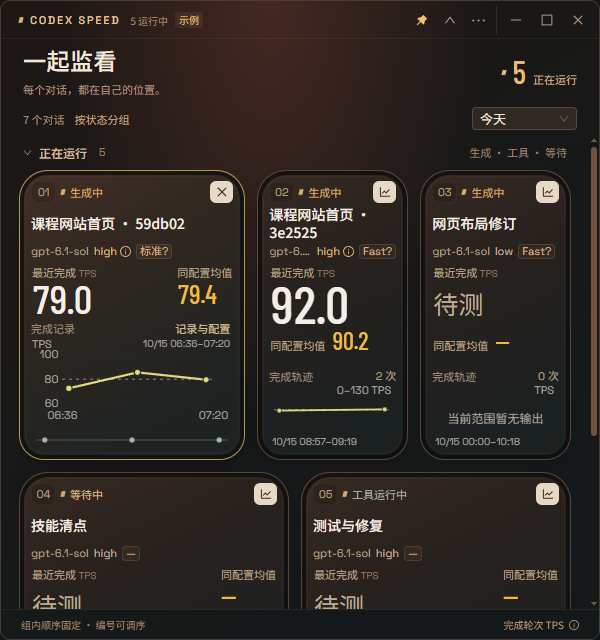

# Codex Speed

**把多个 Codex 对话的输出速度，放到同一块看板上。**

Codex Speed 是一个 Windows 桌面小工具，读取本机 Codex 的会话与计时记录，分别显示各个对话的最近完成速度、同配置均值和历史曲线。多个窗口一起工作时，可以同时观察；模型、思考强度或 Fast 设置不同，也不会被混成一个平均数。

TPS 指每秒输出的 token 数。这里显示的是**每轮输出完成后的速度估算**，不会在生成过程中逐 token 更新。前端、桌面层和统计后端源码均在本仓库；当前提供源码运行方式，没有独立安装包。

## 开始使用

需要 **Windows、Git、Node.js 24 和 Python 3.12**；当前验证环境为 Windows x64，其他系统与架构尚未验证。安装 Python 时建议保留 Python Launcher，便于运行 `py -3.12 --version` 检查；不用 Launcher 时，可按下文指定 Python 可执行文件。首次安装需要联网下载依赖和 Electron；使用面板时不向外发送统计数据，无需管理员权限或重启 Codex。

在 PowerShell 中运行：

```powershell
git clone https://github.com/Ww-Cooooo/codex-speed.git
cd codex-speed
npm ci
npm run build
.\启动演示.cmd
```

演示窗口带有“示例”标记，使用合成数据，不读取你的 Codex。确认能打开后，用右上角关闭按钮退出演示，再双击 `启动统计.cmd`。工具默认读取当前用户的 `.codex` 目录；在 Codex 中完成一次输出后，可在对应对话卡片中查看速度。首次打开会分批补读，部分记录可能显示“待测”或缺少可信计时。

输出已结束的对话可能在收起的“未运行”或“状态待确认”分组中，点组头即可展开；查看子任务时，在三个点菜单中开启“显示子任务”。

请先退出演示再启动统计，避免把示例当成真实读数。正式统计已打开时，再次启动统计入口会恢复现有窗口。



*实际桌面界面，图中均为合成示例数据。*

## 一起看，分别算

- **多对话同时显示。** 每张卡片保留名称、运行状态、输出配置、最近完成 TPS、同配置均值和曲线。生成、工具运行和等待归入“正在运行”；未运行与状态待确认默认收起，子任务默认隐藏。
- **比较时保留配置。** 统计按对话、模型、思考强度、提交／请求／实际档位分别归属。均值按有效生成时间加权，不把不同配置和不同对话混算。当前设置改变后，过去的输出仍属于当时配置。
- **顺序由你决定。** 刷新不会按读数抢占第一位。拖动卡片编号可在同组内调序，点击编号也可前后移动；顺序在重开后保留。状态改变会进入对应分组，组内仍沿用保存的顺序；菜单可切为固定单列表。
- **从扫读到细看。** 点击卡片名称或曲线按钮，可原位展开时间刻度。“记录与配置”提供近1小时、全天、指定日期和自定义范围，也可放大曲线。缺测处断线，未测量不会记成零。
- **桌面上随手放。** 支持边缘缩放、置顶、最大化和保存正常窗口尺寸；可以收起为读数条，或最小化到托盘继续统计。关闭窗口或菜单退出会停止采集，已保存的匿名历史仍保留。

## 读数怎样理解

| 显示内容 | 含义 |
| --- | --- |
| 最近完成 TPS | 有可信计时的一次完成输出：输出 token ÷ 生成秒数。生成前等待和工具执行时间不计入。 |
| 同配置均值 | 所选时段内，同对话、最近完成输出当时配置的有效 token 总量 ÷ 有效生成秒数总量。 |
| `Fast?` | 找到了 Fast 提交或请求证据；尚未确认服务端实际处理档位。悬停可看来源。 |
| `Fast` | 仅在记录已确认实际处理档位时显示。当前采集器尚无这种确认来源。 |
| `—`／待测 | 信息未知、尚无完成输出或缺少可信计时；不是零 TPS，也不会按速度猜测档位。 |

输出 token 可能包含内部推理和工具调用参数，因此读数不等于屏幕文字出现的速度。卡片概览曲线各自聚焦有记录的时间段，需结合显示的起止时刻比较；选中曲线会自动调整纵轴，不能只凭线的高度比较速度。

“今天／近7天／近30天”控制卡片均值时段，记录窗口中的日期范围控制所选曲线。历史最多保留30天、10,000条。工具关闭期间不会持续采集，下次打开只能补读仍存在、能被当前适配器发现的源记录，**不保证完整补回离线期间的全部输出**。Codex 记录格式变化、超出读取预算、日志缺失或计时不明确时，统计可能不完整。

比较过去的配置时，在“记录与配置”窗口的“输出记录的配置”下拉框中选择。所选曲线和记录窗口跟随该配置，卡片主读数及均值仍对应最近完成输出的配置，二者不同时有“所选配置历史”提示。

如果演示可以打开，自己的数据却没有出现，先确认启动的是统计入口、来源目录确实是当前 Codex 使用的 `.codex`，然后完成一轮新输出。可悬停左上角状态点查看提示；只有“待测”或缺测并不等于程序停止。确认来源无误、仍无可信计时时，可以附 Codex 版本和界面状态提 Issue，请勿上传原始数据库、会话 JSONL 或账号配置。当前适配本机 Codex 记录，没有保证所有桌面版／CLI 版本的格式均可计时。

## 本地数据与权限

运行时，界面禁止网络连接、导航到外部页面和任意文件访问；统计后端不上传数据，不读取 `auth.json`、`config.toml`、浏览器凭据或系统钥匙串，也不修改 Codex 程序和配置。

工具会读取本地会话 JSONL、状态／计时数据库及短名称索引。数据库先以二进制方式复制到工具私有临时目录，再查询副本，避免对 Codex 源数据库的辅助文件产生写入。**临时数据库副本可能包含原数据库中的私密标题或日志内容**，正常查询后删除；异常断电或崩溃可能留下副本，下次启动时清理工具自己的旧副本。统计模式下，这些副本位于 `%LOCALAPPDATA%\CodexTPS` 内以 `codex-tps-private-` 开头的目录。

会话名称只用于实时显示，不写入统计历史；JSONL 完整记录会在解码时短暂进入内存，再投影为允许的计时与配置字段，不把聊天正文写入历史。

持久数据在 `%LOCALAPPDATA%\CodexTPS`：匿名会话标识、配置、时间、token与计时、排除原因，以及窗口位置、尺寸、置顶和匿名排序。未保存会话名称或正文。删除项目目录不会删除这份数据；需要清空时，先彻底退出工具，再自行备份或删除该目录。公开截图、问题报告或日志前，请检查是否包含你的会话名称。

为兼容早期版本，数据目录和环境变量继续沿用 `CodexTPS`／`CODEX_TPS` 名称。

## 自定义来源与开发

如果 `.codex` 不在默认位置，在启动前指定来源目录；Python 位于自定义位置时，指定其可执行文件的绝对路径：

```powershell
$env:CODEX_TPS_CODEX_HOME = 'D:\MyCodexData'
$env:CODEX_TPS_PYTHON = 'C:\Path\To\Python312\python.exe'
.\启动统计.cmd
```

上述路径是示例，需要替换。来源目录必须与工具的数据目录分开。

界面采用 React、Ant Design、GSAP、G2、Pts 和 Lenis；Electron 提供窗口与受限通信，Python 标准库负责采集和匿名历史，不需要额外 Python 包。当前在 Windows、Python 3.12 上验证；macOS 和 Linux 尚未验证。

```powershell
# 前端统计、时间范围和桌面输入边界
node --experimental-strip-types --test src/statistics.test.ts src/chart-range.test.ts desktop/validation.test.cjs

# 后端合成数据、计时、配置关联与只读边界
py -3.12 -B -m unittest discover -s backend/tests

# 先退出已打开的小工具，再重新构建并打开启动入口
npm run build
```

源码位置：`src/` 为界面与曲线，`desktop/` 为窗口、托盘及通信边界，`backend/` 为采集、配置归属与历史。测试均使用合成来源，不需要你的 Codex 账号或真实会话。

## 许可与致谢

本项目自有代码采用 [MIT 许可证](LICENSE)，允许使用、修改和分发，需保留许可声明。

计时核心改编自 [TokenPulse](https://github.com/zzccchen/token-pulse) 的固定提交 `edc27b1ab28709e6906667ef50decf12c7002e35`，保留其 [MIT 许可证](backend/TOKENPULSE-LICENSE.txt) 和 [改动说明](backend/THIRD_PARTY.md)，未使用上游安装器、账户配置读取或更新代码。

依赖和字体适用各自许可证，详见 [第三方声明](THIRD_PARTY_NOTICES.md)。GSAP 采用其 Standard License，不属于 MIT；不要把项目许可证理解为对全部第三方依赖重新授权。

本项目是独立社区工具，与 OpenAI 无隶属关系。
